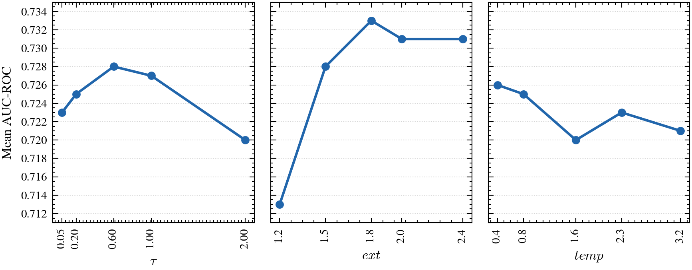

# XGIF: Explanation-Guided Anomaly Detection Extension of Isolation Forest


---

**XGIF** is an explanation-guided extension of [Isolation Forest](https://ieeexplore.ieee.org/document/4781136) that leverages feature attribution signals to drive the isolation process. Instead of relying purely on random splits, XGIF uses attribution stability derived from [DIFFI](https://doi.org/10.1016/j.engappai.2022.105730) to selectively extends tree growth and biases feature selection in regions where attribution patterns indicate unresolved anomalies.

---

## How It Works

XGIF follows a two-stage process:

1. **Warm-start** — train a standard IF and compute Global (GFI) and Local (LFI) feature importances via DIFFI.
2. **Guided tree extension** — build a second forest with two modifications:
   - **Attribution stability criterion`(Mechanism 1)`**: extend tree growth beyond `d_max` only when a leaf contains instances with heterogeneous attribution profiles (likely anomalies).
   - **GFI-guided feature selection`(Mechanism 2)`**: in the extended zone, sample splitting features proportionally to their GFI score rather than uniformly.

The two forests are fully independent, ensuring non-circularity.


---

## Results

Evaluated on **20 tabular benchmark datasets** from [ADBench](https://arxiv.org/abs/2206.09426), covering healthcare, finance, image, and network intrusion domains.

| Model | Mean AUC | Win Score |
|---|---|---|
| IF| 0.710 ± 0.023 | 2/20 |
| **XGIF** | **0.727 ± 0.022** | **17/20** |

XGIF outperforms standard IF on **17 out of 20 datasets** (Wilcoxon signed-rank test, p < 0.05), with the largest gains on WILT (+6.9%), VOWELS (+6.4%), ANNTHYROID (+3.8%), LETTER (+3.1%), WINE (+2.9%), and SKIN (+1.8%).

Runtime overhead is minimal thanks to DIFFI's model-specific design.

---

## Ablation Study

To isolate each mechanism's contribution, we evaluate four configurations in addition to the IF baseline.

| Configuration | Description |
|---|---|
| **XGIF-A** | Mechanism 1 (attribution-guided growth) only |
| **XGIF-B** | Mechanism 2 (GFI-guided feature selection) applied uniformly across the full tree |
| **XGIF-AB** | Both mechanisms applied across the full tree |
| **XGIF** | Full method: Mechanism 1 + Mechanism 2 restricted to the extended zone only |

**Results on 20 ADBench datasets:**

| Configuration | Mean AUC | Win Score |
|---|---|---|
| IF baseline | 0.710 ± 0.023 | — |
| XGIF-A (growth only) | 0.721 ± 0.021 | 16/20 |
| XGIF-B (feat. sel. only, full tree) | 0.701 ± 0.033 | 9/20 |
| XGIF-AB (growth + feat. sel., full tree) | 0.711 ± 0.034 | 11/20 |
| **XGIF** (growth + feat. sel., extended zone) | **0.727 ± 0.022** | **17/20** |

Three key findings emerge from this ablation:

1. **Attribution-guided growth is the dominant mechanism.** XGIF-A alone achieves 16/20 wins and a +0.011 mean AUC gain over baseline.
2. **Applying GFI-guided selection across the full tree is counterproductive.** XGIF-B degrades below baseline (0.701 vs. 0.710), and XGIF-AB barely exceeds it (0.711). Uniform application interferes with the standard IF construction in the shallow region.
3. **The two mechanisms are complementary when properly scoped.** XGIF outperforms XGIF-A on both win count (17/20 vs. 16/20) and mean AUC (0.727 vs. 0.721), confirming that restricting GFI-guided selection to the extended zone is the right design choice.


## Sensitivity Analysis

We conduct a one-at-a-time sensitivity analysis over XGIF's three hyperparameters.We report mean AUC-ROC averaged over 20 datasets (5 runs per dataset, same seeds across configurations).


*Figure: Sensitivity of XGIF to its three hyperparameters on 20 ADBench datasets (mean AUC-ROC). Each hyperparameter is varied independently while the other two are fixed at the reference configuration: `τ = 0.6`, `ext = 1.3`, `temp = 1`.*

**Purity threshold τ**

Performance peaks at **τ = 0.6** (AUC = 0.728) and remains stable across [0.2, 1.0], indicating low sensitivity to this parameter. Very small values (τ = 0.05) trigger excessive extensions; overly large values (τ = 2) stop too early. Both extremes incur only a marginal drop. The normalization by σ̄ makes the threshold interpretable and easy to set across datasets.

**Extension factor ext**

This is the **most influential hyperparameter**. Performance jumps from 0.713 at ext = 1.2 to a plateau of ≈ 0.73 from ext = 1.5 onward, peaking at ext = 1.8 (AUC = 0.733). A too-small budget leaves anomalies insufficiently isolated, while deeper extensions (ext ≥ 2) bring no further benefit. A moderate extension is both necessary and sufficient.

**Temperature temp**

Performance is highest at low temperature (temp = 0.4, AUC = 0.726) and decreases mildly as temp increases, remaining within a narrow [0.720, 0.726] band. Lower temperatures better exploit the GFI signal by concentrating feature selection on the most informative attributes; higher temperatures progressively approach uniform random selection. The overall effect remains small.

**Overall:** XGIF delivers stable performance over a wide range of settings, with only the extension factor requiring a minimal value to be effective.

## Installation

```bash
git clone https://github.com/lordnel/XGIF.git
cd XGIF
pip install numpy
```

---

## Usage

```python
from xgif.forest import IsoForest

model = IsoForest(
    t=100,              # number of trees
    psi=256,            # subsample size
    tau=0.6,            # purity threshold
    ext=1.3,            # extension factor
    temp=0.6,           # softmax temperature
)

model.fit(X_train)
scores = model.anomaly_score(X_test)  # higher = more anomalous
```